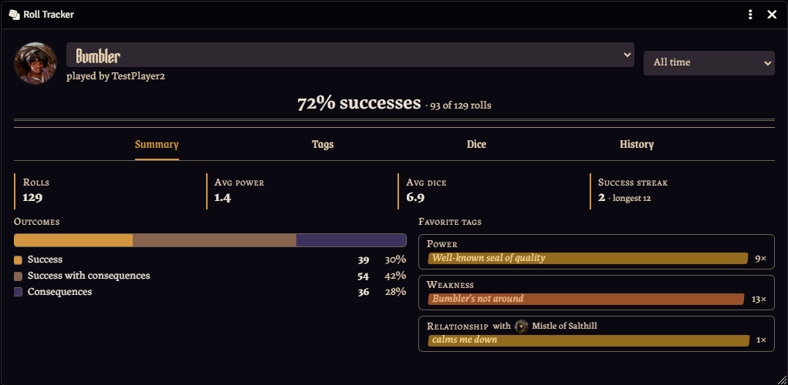

# Legend in the Mist: Roll Tracker

A Foundry VTT module for the [Legend in the Mist](https://github.com/Son-of-Oak-Community/litmv2) system (`litmv2`). It records every roll your heroes make and shows statistics for each hero: outcomes, Power, dice luck, favorite tags, and a full roll history.



## Features

- **Tracks every roll** for the hero it belongs to, in every roll mode, including Acting Together (counted for each hero taking part) and Helping Each Other (contributed tags count for the hero who owns them).
- **Roll Tracker window**, opened from the left toolbar by anyone:
  - **Summary:** roll count, average Power and dice, success streaks, outcome split, favorite power, weakness and relationship tags
  - **Tags:** top power, weakness and relationship tags, lucky tags, most burned tags
  - **Dice:** a 2–12 histogram, the average of the last 10 rolls (noting hot and cold streaks), double 1s and 6s
  - **History:** every roll, newest first; expand one to see its dice, tags and statuses
  - Pick a hero (or all heroes) and a range (all time, or one session)
- **Sessions** (GM): start and end game sessions from the toolbar, then view stats per session.
- **Manage roll data** (GM, in module settings): reset rolls for some or all heroes, and pause tracking.
- Light and dark mode, following Foundry's color scheme, with fonts and tag colors that match litmv2.

## Requirements

- Foundry VTT v14
- The `litmv2` game system

## How it works

- Rolls are saved by the active GM in a hidden journal, so **a GM must be online** for rolls to be recorded. A world setting decides whether players are warned when no GM is online.
- Every player can see every hero's stats.
- Stats refresh each time the Roll Tracker window is opened.

## Installing

In Foundry's setup screen, go to **Add-on Modules → Install Module**, paste this manifest URL into the **Manifest URL** field, and press **Install**:

```
https://github.com/anourGH/litm-roll-tracker/releases/latest/download/module.json
```

Then enable **Legend in the Mist: Roll Tracker** in your world's module settings.

### For testing

Turn on **Developer mode** in the module settings to add a Fake data tab to **Manage roll data**. It generates sample rolls from your heroes' real tags, and can remove them again.

## AI Disclosure

Claude Code was used as a coding assistant throughout the development of this module to draft code and suggest interface text. All included code and text was reviewed and tested by me directly before release. This module contains no AI-generated art or media.

## License

The code is released under the [MIT License](LICENSE).

Legend in the Mist is a product of Son of Oak Game Studio. This is an unofficial fan project and is not affiliated with or endorsed by Son of Oak. The module includes no Legend in the Mist rules text, art or fonts: outcome icons and fonts are used from the installed `litmv2` system at runtime.
